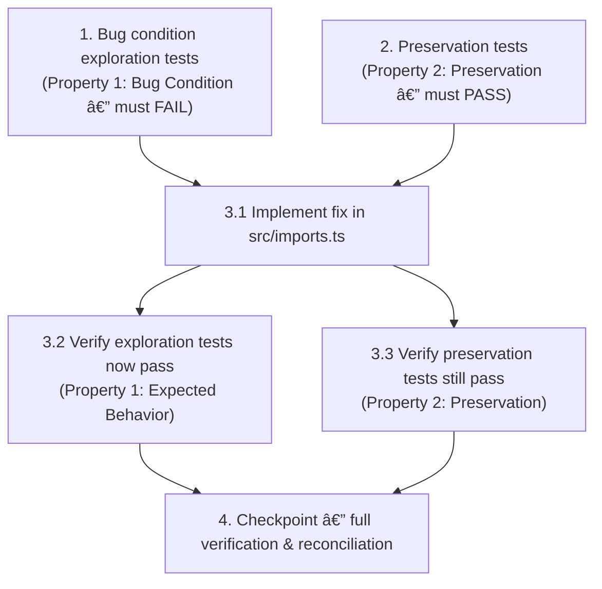

# Implementation Plan

## Overview

This plan fixes a timezone handling bug in `adaptHospital` (in `src/imports.ts`) where hospital objects routed through the JSON adaptation path fail to import because the timezone is supplied only under an alias key (`time_zone` / `local_timezone`) and/or as a `"Label (IANA/Zone)"` label. In those cases `Temporal.Now.zonedDateTimeISO(h.timezone)` throws on `undefined` or a non-IANA label, so the official bundle and alias/labeled objects fail to import.

The fix introduces a single shared `normalizeTimezone` helper that resolves the aliases and extracts the IANA identifier, applied consistently across the adaptation branches, without touching schema validation, the CSV path, or any input that already yields a clean IANA zone.

The work follows the exploratory bugfix order:
1. **Explore** — write bug condition tests first; they must FAIL on unfixed code to confirm the bug (Property 1: Bug Condition).
2. **Preserve** — write preservation tests first; they must PASS on unfixed code to pin baseline behavior (Property 2: Preservation).
3. **Implement** — apply the confined fix in `src/imports.ts`.
4. **Validate** — re-run the same tests (exploration now passes, preservation still passes) and run the full checkpoint.

## Task Dependency Graph

The dependency order is: the two pre-fix test tasks (1 and 2) must come before the implementation sub-task 3.1; 3.1 must come before the verification sub-tasks 3.2 and 3.3; and all of the above must complete before the final checkpoint (task 4).



```json
{
  "waves": [
    { "wave": 1, "parallel": true, "tasks": ["1", "2"] },
    { "wave": 2, "parallel": false, "tasks": ["3.1"] },
    { "wave": 3, "parallel": true, "tasks": ["3.2", "3.3"] },
    { "wave": 4, "parallel": false, "tasks": ["4"] }
  ]
}
```

## Tasks

- [x] 1. Write bug condition exploration tests (BEFORE implementing the fix)
  - **Property 1: Bug Condition** - Timezone alias resolution and IANA normalization
  - Create new file `tests/imports.test.ts` (Vitest, matching the existing `tests/*.test.ts` convention), importing `previewImport` from `../src/imports` and `readFileSync` from `node:fs`.
  - **CRITICAL**: These tests MUST FAIL on the unfixed code — the failures confirm the bug exists (`adaptHospital` never resolves a timezone alias or extracts the IANA identifier from a `"Label (IANA/Zone)"` value, so `Temporal.Now.zonedDateTimeISO(h.timezone)` throws on `undefined` or a non-IANA label).
  - **DO NOT attempt to fix the test or the code when it fails** at this step.
  - **NOTE**: These tests encode the expected behavior — they will validate the fix when they pass after implementation.
  - **GOAL**: Surface counterexamples that demonstrate the bug for inputs routed through `adaptHospital` where `isBugCondition(input)` is true.
  - **Scoped PBT Approach**: this is a deterministic bug, so scope the properties to the concrete failing cases below rather than generating a wide random domain.
  - Test case 1 (headline): `previewImport(readFileSync("data/raw/hospital_guides.json","utf8"), "json")` returns `errors.length > 0` and `hospitals.length === 0` on unfixed code (official bundle carries labeled timezones like `"Central (America/Chicago)"`).
  - Test case 2 (labeled-timezone object): a single hospital object with `timezone: "Central (America/Chicago)"` and object-shaped `fields` returns `errors.length > 0` on unfixed code.
  - Test case 3 (alias-only `local_timezone`): a single object with `local_timezone: "America/Denver"` and no `timezone` key returns `errors.length > 0` on unfixed code.
  - Test case 4 (snake-case alias `time_zone`): a single object with `time_zone: "America/New_York"` and no `timezone` key returns `errors.length > 0` on unfixed code.
  - Run tests on UNFIXED code with `npm run test`.
  - **EXPECTED OUTCOME**: Tests FAIL (this is correct — it proves the bug exists). If they do NOT fail, the root-cause hypothesis is refuted and must be re-examined before proceeding.
  - Document the counterexamples observed (e.g. `Temporal.Now.zonedDateTimeISO("Central (America/Chicago)")` throws; alias-only objects yield `timezone === undefined`).
  - Mark this task complete when the tests are written, run, and the failures are documented.
  - _Requirements: 1.1, 2.1, 2.2_

- [x] 2. Write preservation tests (BEFORE implementing the fix)
  - **Property 2: Preservation** - Clean-timezone and non-`adaptHospital` inputs unchanged
  - Add these tests to `tests/imports.test.ts` (same new file as task 1).
  - **IMPORTANT**: Follow the observation-first methodology — run the UNFIXED code for inputs where `isBugCondition` is false, record the actual outputs, then assert those observed outputs so the tests pin real baseline behavior.
  - Test case 1 (holdout object form): `previewImport(readFileSync("data/holdout/unfamiliar-hospitals.json","utf8"), "json")` yields `errors === []` and `hospitals.length === 4` on unfixed code. (The entire existing `tests/holdout.test.ts` must also continue to pass unchanged — do not modify it.)
  - Test case 2 (clean-IANA object): a hospital object already carrying `timezone: "America/Los_Angeles"` with object-shaped `fields` imports with `errors === []` on unfixed code; capture the adapted hospital's `timezone` and `fields` as the golden baseline.
  - Test case 3 (CSV path unaffected): a CSV import exercising the timezone column (reuse the `data/holdout/mapped-import.csv` mapping pattern from `tests/holdout.test.ts`) yields `errors === []` on unfixed code — the CSV path never calls `adaptHospital`.
  - Test case 4 (error paths still error): malformed JSON (e.g. `'{"id":'`), oversized input (`"x".repeat(1_000_001)`), and a cross-hospital-contaminated object each return `errors.length > 0` on unfixed code.
  - Property-based option (recommended): generate hospital objects with a random clean IANA zone drawn from a fixed set and random object-shaped fields; assert `previewImport` succeeds and `timezone` is the drawn zone — this will stay true after the fix (preservation).
  - Run tests on UNFIXED code with `npm run test`.
  - **EXPECTED OUTCOME**: These preservation tests PASS on unfixed code (confirming the baseline behavior to preserve).
  - Mark this task complete when the tests are written, run, and passing on unfixed code.
  - _Requirements: 3.1, 3.2, 3.3_

- [x] 3. Fix for timezone alias resolution and IANA normalization in `adaptHospital`

  - [x] 3.1 Implement the fix in `src/imports.ts`
    - Add a shared `normalizeTimezone(raw: Record<string, unknown>): string` helper (single source of truth): resolve the raw zone value in order `raw.timezone ?? raw.time_zone ?? raw.local_timezone`; coerce to string; if it matches `/\((.*?)\)/`, return the captured parenthetical IANA identifier (e.g. `America/Chicago`), otherwise return the trimmed value unchanged; return `""` when no alias is present.
    - In both `adaptHospital` object branches (the `Array.isArray(raw.fields)` branch and the `raw.fields` object branch), add `timezone: normalizeTimezone(raw)` to the returned object, placed after the `...raw` spread so it overrides any raw `timezone` key. Do not touch `id`, `name`, `version`, or the fields mapping.
    - Replace the inline `String(h.timezone).match(/\((.*?)\)/)?.[1] || h.timezone` expression in the reconstructed-bundle (`x.hospitals` + `x.fields`) branch with a call that routes through `normalizeTimezone`, so the two paths cannot diverge and the computed value stays byte-for-byte identical for current inputs.
    - Do NOT change `hospitalSchema`, `mapRecord`, `fromRecords`, `suggestMap`, the `aliases` map, or `previewImport`'s validation/bounds logic. The change is confined to the adaptation path.
    - _Bug_Condition: isBugCondition(input) — object routed through adaptHospital whose timezone is present only under an alias (`time_zone`/`local_timezone`) and/or as a `"Label (IANA/Zone)"` label, where a valid IANA zone is recoverable_
    - _Expected_Behavior: expectedBehavior(result) — adapted hospital carries a valid IANA `timezone` accepted by `Temporal.Now.zonedDateTimeISO`, so the hospital imports with all fields retained_
    - _Preservation: inputs already yielding a valid IANA zone, the CSV path, and inputs that never reach adaptHospital are unaffected; `normalizeTimezone` returns the same string for already-clean IANA values_
    - _Requirements: 2.1, 2.2, 3.1, 3.2, 3.3_

  - [x] 3.2 Verify the bug condition exploration tests now pass
    - **Property 1: Expected Behavior** - Timezone alias resolution and IANA normalization
    - **IMPORTANT**: Re-run the SAME tests from task 1 — do NOT write new tests. Those tests encode the expected behavior.
    - Run the exploration tests from task 1 with `npm run test`.
    - **EXPECTED OUTCOME**: All four exploration tests now PASS, confirming the bug is fixed (official bundle imports; labeled, `local_timezone`, and `time_zone` objects all import with a valid IANA `timezone`).
    - _Requirements: 2.1, 2.2_

  - [x] 3.3 Verify the preservation tests still pass
    - **Property 2: Preservation** - Clean-timezone and non-`adaptHospital` inputs unchanged
    - **IMPORTANT**: Re-run the SAME tests from task 2 and the existing `tests/holdout.test.ts` — do NOT write new tests.
    - Run `npm run test`.
    - **EXPECTED OUTCOME**: All preservation tests PASS, `tests/holdout.test.ts` still passes unchanged (4-hospital holdout result, CSV mapping, error paths), and the clean-IANA golden baseline is byte-for-byte identical (no regressions).
    - _Requirements: 3.1, 3.2, 3.3_

- [x] 4. Checkpoint - Full verification and acceptance reconciliation
  - Add an integration assertion in `tests/imports.test.ts`: `previewImport(readFileSync("data/raw/hospital_guides.json","utf8"), "json")` yields `errors === []` and `hospitals.length === 7`.
  - Read `p.counts.supported` from the actual run and reconcile it against the 159 target. The 159 figure is interpretation-dependent (169 total field records across 7 hospitals, classified by `interpretation()` in `src/knowledge.ts`); it is NOT simply 169 minus the 7 "Local Time Zone" rows. If the observed supported count differs from 159, FLAG the discrepancy as a finding to resolve (restate the target from the measured counts or investigate an interpretation gap) rather than silently overwriting it.
  - Confirm `activate(seedHospitals, imported)` behaves as before for the imported official hospitals (no new version collisions introduced by the fix).
  - Run `npm run typecheck`, `npm run test`, and `npm run build`; ensure all pass.
  - Ensure all tests pass; if questions or discrepancies arise, surface them to the user rather than overwriting the target.
  - _Requirements: 1.1, 2.1, 2.2, 3.1, 3.2, 3.3_

## Notes

- **159 supported-count caveat**: The 159 target in task 4 is interpretation-dependent, not a simple arithmetic result. There are 169 total field records across the 7 official hospitals, classified by `interpretation()` in `src/knowledge.ts`; 159 is NOT simply 169 minus the 7 "Local Time Zone" rows. If the measured `p.counts.supported` after the fix differs from 159, treat the gap as a finding to reconcile (restate the target from the measured counts or investigate an interpretation gap) rather than silently overwriting the target.
- **Single source of truth**: The reconstructed-bundle branch and the two object branches must all route timezone resolution through the same `normalizeTimezone` helper so the paths cannot diverge; for already-clean IANA values the helper must return the identical string (byte-for-byte) to guarantee preservation.
- **Scope confinement**: The fix is limited to the adaptation path. Schema validation (`hospitalSchema`), record mapping (`mapRecord`, `fromRecords`, `suggestMap`), the `aliases` map, the CSV path, and `previewImport`'s validation/bounds logic are intentionally left unchanged.
