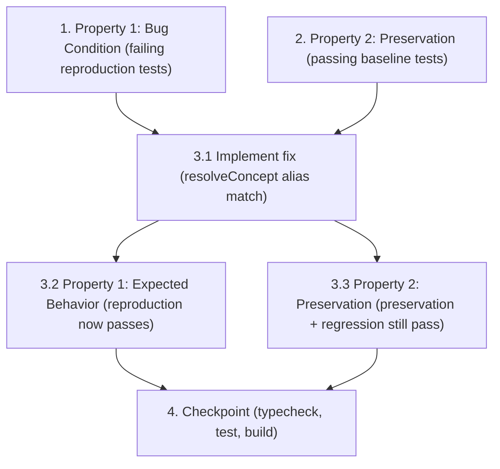

# Implementation Plan

## Overview

Fix the free-text question router so that short concept aliases no longer match the
*interior* of unrelated words. The defect lives in a single line of the alias scoring loop
inside `resolveConcept` (`src/knowledge.ts`): `if (n.includes(x))` uses raw substring
containment, so `"ai"` is found inside `"available"` and the question **"Is EVT available?"**
at hospital **SYN-006** is misrouted to the `AI` field — which SYN-006's guide does not
define — producing a confidently wrong `not_in_guide` ("AI is absent") answer.

The fix replaces substring containment with a whole-token (word-boundary) check that still
matches multi-word alias phrases: `if ((" " + n + " ").includes(" " + x + " "))`. This relies
on the existing `normalize` invariant (single-space-delimited, punctuation-stripped tokens).
Nothing else changes — not `normalize`, not the alias-character-length scoring metric, not the
highest-score selection, not the tie → clarification semantics, and not the three post-loop
regex shortcuts (order set, rounding orders, who-mixes).

The work is strictly test-driven and follows the exploratory bugfix order: write a failing
reproduction (Bug Condition) test first, write passing preservation tests first (observation-
first), then apply the one-line fix and confirm the reproduction flips to passing while all
preservation and regression suites stay green.

All new tests go in a new `tests/question-router.test.ts` (Vitest, matching the existing
`tests/*.test.ts` convention). `SYN-006` is obtained from `seedHospitals` in `src/data`;
`resolveConcept`/`normalize` come from `src/knowledge`; `ask`/`answerField` from `src/engine`;
`freshContext` from `src/domain`.

## Task Dependency Graph



```json
{
  "waves": [
    { "wave": 1, "parallel": true, "tasks": ["1", "2"] },
    { "wave": 2, "parallel": false, "tasks": ["3.1"] },
    { "wave": 3, "parallel": true, "tasks": ["3.2", "3.3"] },
    { "wave": 4, "parallel": false, "tasks": ["4"] }
  ]
}
```

## Tasks

- [x] 1. Write bug condition exploration tests (BEFORE implementing the fix)
  - **Property 1: Bug Condition** - Interior-substring aliases misroute the router
  - **IMPORTANT**: Write these property-based tests in a new `tests/question-router.test.ts` (Vitest) BEFORE touching `src/knowledge.ts`
  - **CRITICAL**: These tests MUST FAIL on the unfixed code — the failure is what confirms the bug exists. **DO NOT attempt to fix the test or the code when they fail.**
  - **NOTE**: These tests encode the expected post-fix behavior; they will validate the fix when they pass in task 3.2
  - **GOAL**: Surface counterexamples that demonstrate `n.includes(x)` ignores token boundaries
  - **Scoped PBT Approach**: the EVT→AI case is deterministic, so scope the property to the concrete failing input `("Is EVT available?", SYN-006)`; for the embedded-alias property, generate filler words that embed a short alias (`"ai"`, `"tee"`, `"eeg"`, `"evt"`, `"ct"`) as an interior substring (append/prepend letters) and assert the associated field is scored today
  - Import `resolveConcept`, `normalize` from `../src/knowledge`; `ask` from `../src/engine`; `freshContext` from `../src/domain`; `seedHospitals` from `../src/data`; look up `SYN-006` via `seedHospitals.find(h => h.id === "SYN-006")`
  - Test case 1 (primary acceptance): assert `resolveConcept("Is EVT available?", SYN-006).field === "AI"` on unfixed code (because `"is evt available".includes("ai")` is true inside `"available"`)
  - Test case 2 (end-to-end): assert `ask(SYN-006, freshContext(SYN-006), "Is EVT available?")` returns a `not_in_guide` "AI is absent" answer on unfixed code
  - Test case 3 ("tee" inside "guarantee"): assert a question containing the word `"guarantee"` scores the `TEE` field via alias `"tee"` on unfixed code
  - Test case 4 (short alias embedded in a longer word): assert a question embedding `"eeg"`/`"evt"`/`"ct"` inside an unrelated word scores the associated field on unfixed code
  - Run the tests on UNFIXED code
  - **EXPECTED OUTCOME**: Tests FAIL (this is correct — it proves the bug exists)
  - Document the counterexamples found (e.g. `resolveConcept("Is EVT available?", SYN-006).field === "AI"`; `" is evt available ".includes(" ai ")` is false while `.includes("ai")` is true)
  - Mark complete when the tests are written, run, and their failure is documented
  - _Bug_Condition: isBugCondition(Q, H) — substringContains(n, x) AND NOT wholeTokenContains(n, x), e.g. Q="Is EVT available?", H=SYN-006, alias x="ai"_
  - _Expected_Behavior: expectedBehavior(result) — resolveConcept'("Is EVT available?", SYN-006).field != "AI"; ask' yields clarification, not a not_in_guide "AI is absent" answer_
  - _Requirements: 1.1, 1.2, 1.3, 2.1, 2.2_

- [x] 2. Write preservation property tests (BEFORE implementing the fix)
  - **Property 2: Preservation** - Non-bug inputs behave identically
  - **IMPORTANT**: Follow the observation-first methodology — run the UNFIXED code first, record the actual `field`/`candidates`/statuses, then assert those observed values in `tests/question-router.test.ts`
  - These tests MUST PASS on the unfixed code (they capture the baseline to preserve)
  - Observe & assert SYN-006 fixture routing is unchanged:
    - **V06** `"What is the LVO pathway after 1900 on a weekday?"` → `LVO Protocol` (whole-token `"lvo"` / phrase `"lvo pathway"` still matches)
    - **V09** `"Patient has an LVO. Do I activate the EVT team?"` → `LVO Protocol` (multi-word alias `"evt team"` matches as a contiguous phrase; `"lvo"` is a whole token)
    - **V18** `"Who mixes the TNK?"` → `Thrombolytic Mix Model` via the `/who.*mix/` shortcut
  - Whole-token still matches (2.3): `"What is the AI software?"` still scores `AI` (standalone `"ai"` token and `"ai software"` phrase both present)
  - Multi-word phrase still matches (2.4): `"Does the hospital have CT perfusion?"` still scores `CT Perfusion` via the contiguous phrase `"ct perfusion"`
  - Shortcut parity (3.2): `"Which order set should I use?"` → `Order Set Name`; a rounding order-change question → `Rounding Orders`; a who-mixes/who-prepares question → `Thrombolytic Mix Model`
  - Tie parity (3.3) and no-match parity (3.4): assert that inputs which tie or match nothing return the same `candidates` / `field: undefined` as the unfixed baseline
  - Property-based preservation: generate `(question, hospital)` pairs from the fixture corpus and seeded hospitals; for each pair where the bug condition does NOT hold, assert `field` and `candidates` match the unfixed baseline (property-based testing gives a strong "for all non-buggy inputs" guarantee and catches boundary cases: leading/trailing spaces, phrase-vs-token, empty alias)
  - Run the tests on UNFIXED code
  - **EXPECTED OUTCOME**: Tests PASS (this confirms the baseline behavior to preserve)
  - Mark complete when the tests are written, run, and passing on unfixed code
  - _Preservation: For all (Q, H) where isBugCondition(Q, H) is false, resolveConcept(Q, H) == resolveConcept'(Q, H) on both field and candidates — scoring metric, highest-score selection, whole-token/phrase matches, tie → clarification semantics, and the three post-loop regex shortcuts all unchanged_
  - _Requirements: 2.3, 2.4, 2.5, 3.1, 3.2, 3.3, 3.4_

- [x] 3. Fix for the interior-substring alias misroute in `resolveConcept`

  - [x] 3.1 Implement the whole-token match fix
    - In `src/knowledge.ts`, inside the `resolveConcept` alias scoring loop (`for (const a of aliases) { const x = normalize(a); ... }`), change ONLY the match test
    - Before: `if (n.includes(x)) score = Math.max(score, x.length);`
    - After: `if ((" " + n + " ").includes(" " + x + " ")) score = Math.max(score, x.length);`
    - Do NOT change `normalize`, the scoring metric (`Math.max(score, x.length)`), the `ranked` sort / `top` / `candidates` de-duplication / `field: candidates.length === 1 ? top.field : undefined` selection and tie logic, or the three post-loop regex shortcuts (`/order set/i`, the rounding branch, `/who.*mix|who.*prepar/i`)
    - No empty-alias handling is needed: an empty normalized alias `x = ""` scores length 0 (no effect), exactly as under `includes`
    - _Bug_Condition: isBugCondition(input) — substringContains(n, x) AND NOT wholeTokenContains(n, x), where wholeTokenContains(n, x) = (" " + n + " ").includes(" " + x + " ")_
    - _Expected_Behavior: expectedBehavior(result) — a field is scored only when an alias appears as a contiguous run of complete tokens in normalize(Q); resolveConcept'("Is EVT available?", SYN-006).field != "AI"_
    - _Preservation: Preservation Requirements from design — normalize, scoring metric, selection/tie logic, and the three post-loop regex shortcuts untouched_
    - _Requirements: 2.1, 2.2, 2.4, 2.5_

  - [x] 3.2 Verify the bug condition exploration tests now pass
    - **Property 1: Expected Behavior** - Interior-substring aliases no longer score
    - **IMPORTANT**: Re-run the SAME tests from task 1 — do NOT write new tests. The task 1 tests encode the expected behavior; their passing confirms it
    - Re-run the task 1 tests in `tests/question-router.test.ts`
    - **EXPECTED OUTCOME**: Tests PASS — `resolveConcept("Is EVT available?", SYN-006).field !== "AI"`; `ask(SYN-006, ctx, "Is EVT available?")` yields a clarification (or a legitimately matching field), NOT the `not_in_guide` "AI is absent" answer; the `"tee"`-in-`"guarantee"` and embedded-alias cases no longer score their fields
    - _Expected_Behavior: expectedBehavior(result) from design — Property 1; resolveConcept'("Is EVT available?", SYN-006).field != "AI"_
    - _Requirements: 2.1, 2.2_

  - [x] 3.3 Verify the preservation tests still pass
    - **Property 2: Preservation** - Non-bug inputs still behave identically
    - **IMPORTANT**: Re-run the SAME tests from task 2 — do NOT write new tests
    - Re-run the task 2 preservation tests in `tests/question-router.test.ts`, plus the existing `tests/holdout.test.ts` and `tests/triggers.test.ts` regression suites
    - **EXPECTED OUTCOME**: All pass with identical resolved `field`s and statuses (SYN-006 fixtures V06/V09/V18 unchanged; whole-token `AI`, multi-word `CT Perfusion`, the three shortcuts, and tie/no-match parity all preserved; no regressions)
    - _Preservation: Preservation Requirements from design — Property 2; same field and candidates for all non-bug inputs_
    - _Requirements: 2.3, 2.4, 2.5, 3.1, 3.2, 3.3, 3.4, 3.5_

- [x] 4. Checkpoint - Ensure all checks and tests pass
  - Run `npm run typecheck` (`tsc --noEmit`) — expect no type errors from the one-line change
  - Run `npm run test` (`vitest run`) — expect the full suite green, including the new `tests/question-router.test.ts`, `tests/holdout.test.ts`, and `tests/triggers.test.ts`
  - Run `npm run build` (`tsc --noEmit && vite build`) — expect a clean build
  - Confirm the acceptance outcome: `ask(SYN-006, ctx, "Is EVT available?")` produces a clarification request (not the wrong AI `not_in_guide` answer), and full regression is green
  - Ensure all tests pass; ask the user if questions arise
  - _Requirements: 2.1, 2.2, 2.3, 2.4, 2.5, 3.1, 3.2, 3.3, 3.4, 3.5_

## Notes

- **Scope confinement**: the fix is a single-line change to the alias match test inside the
  `resolveConcept` scoring loop in `src/knowledge.ts` — `if (n.includes(x))` becomes
  `if ((" " + n + " ").includes(" " + x + " "))`. Nothing else is modified: `normalize` keeps
  its definition, the scoring metric stays `Math.max(score, x.length)` (alias character
  length), the `ranked` sort / `top` / `candidates` de-duplication / tie →
  `field: undefined` selection logic is untouched, and the three post-loop regex shortcuts
  (`/order set/i`, the rounding `orders?|antiplatelet|medication|change` branch, and
  `/who.*mix|who.*prepar/i`) are left exactly as they are. No other files change. No unrelated
  refactoring.
- **Normalize single-space invariant the fix relies on**: `normalize(s)` lowercases, replaces
  every run of non-alphanumeric characters with a single space (`/[^a-z0-9]+/g` → `" "`), and
  trims. This guarantees tokens are separated by exactly one space and that trailing
  punctuation is stripped (`"available?"` → `"available"`). Padding both the normalized
  question and the normalized alias with a single space on each side therefore turns
  `.includes` into a true whole-token / whole-phrase boundary check: an alias matches only when
  it appears as a contiguous run of complete, space-delimited tokens. Multi-word aliases such
  as `"ct perfusion"` match only when the full phrase appears as adjacent tokens. If this
  single-space normalization invariant were weakened, the fix's boundary check would no longer
  hold — hence it is called out explicitly.
- **Property mapping**: Property 1 (Bug Condition / Expected Behavior) is covered by tasks 1
  and 3.2; Property 2 (Preservation) by tasks 2 and 3.3. The reproduction tests must fail on
  unfixed code and pass after the fix; the preservation tests must pass both before and after.
