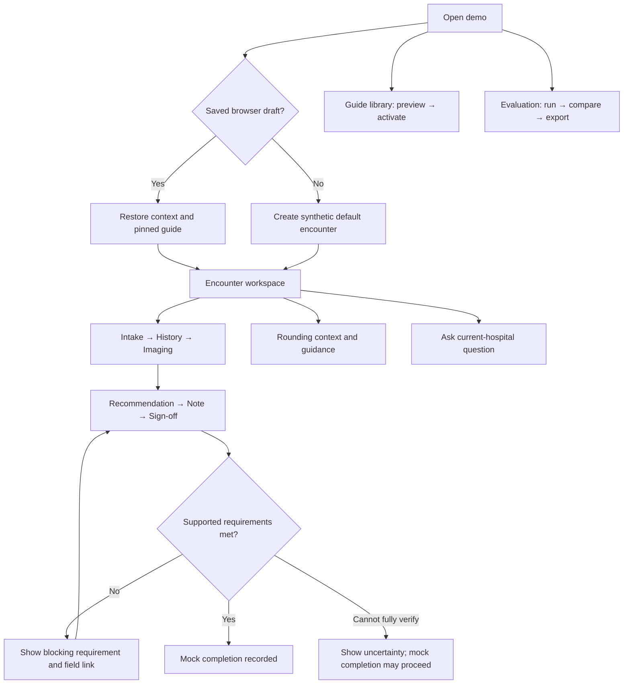
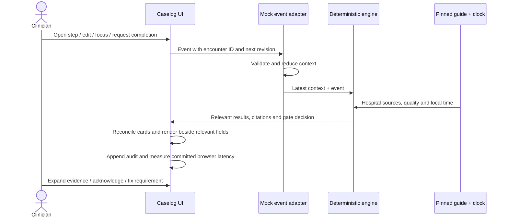
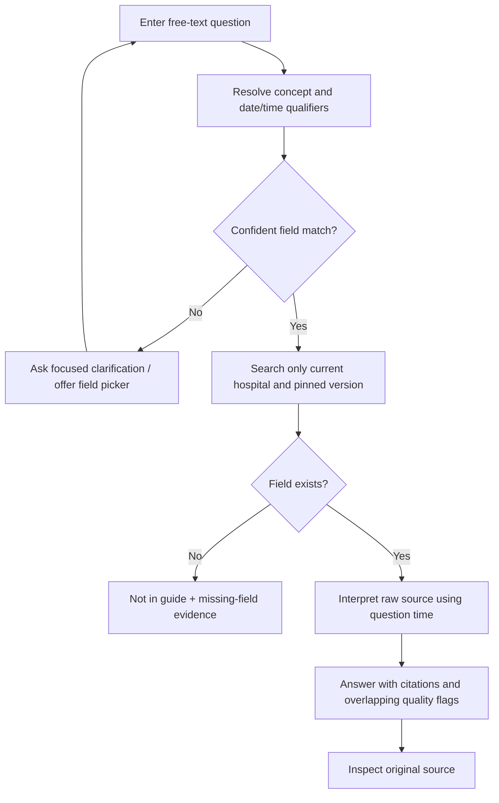
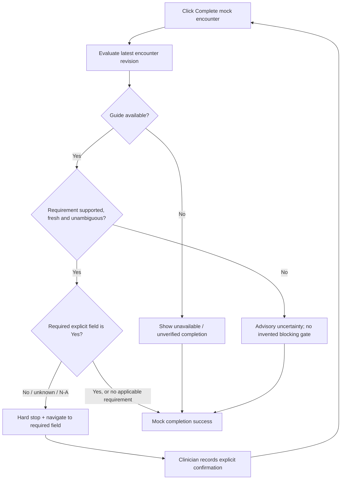
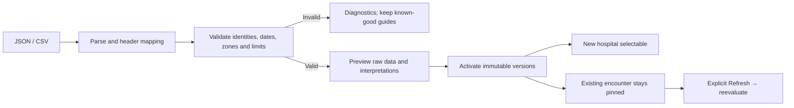

# Encounter Guide: detailed application workflow

Version 1.0 · Implemented prototype · October 10, 2026

This specification describes the running application. All hospitals and encounters are synthetic. The prototype records local workflow statements; it does not place orders, post charges, connect video, sign clinical notes, or complete a production encounter. The source plan defines the product requirements; the flows below reflect the actual implementation and its documented prototype policies.

## 1. People, workspaces and entry point

| Person                            | Workspace               | Objective                                                     | Boundary                                                |
| --------------------------------- | ----------------------- | ------------------------------------------------------------- | ------------------------------------------------------- |
| Clinician demonstrating a consult | Encounter               | Record the caselog and review source-backed hospital guidance | Browser-local draft; no real patient information        |
| Guide maintainer                  | Guide library           | Inspect, import and activate synthetic hospital guides        | Versions are immutable; existing encounters stay pinned |
| Evaluator / teammate              | Evaluation              | Run sponsor examples, inspect evidence and export results     | Oracle fixtures are separate from product rules         |
| Developer                         | GitHub + local checkout | Change behavior, test unfamiliar data, submit a pull request  | No production access or paid runtime service required   |

There is no login or role enforcement. These are responsibilities, not access-control roles. Opening the application restores this origin's saved draft and guide versions or creates the default encounter. The default is Highland Valley (SYN-006), Stroke / Acute, paused at Tuesday March 17, 2026, 19:30 Central. Demo controls make the simulated time explicit.

## 2. Context selection and encounter identity

1. Select a hospital. The application creates a fresh encounter for that hospital and clears incompatible field values, answers, acknowledgements and completion state.
2. Select consult type (Stroke or General Neuro) and encounter type (Acute or Rounding). These qualifiers affect relevant guidance; they do not identify a real patient.
3. Review the hospital name, pinned guide version, hospital-local date/time and IANA timezone in the context strip. Provider timezone is a separate display preference.
4. Open a caselog step. Navigation preserves entered values and is intentionally flexible; this prototype does not require every field before advancing.
5. Use Demo controls to change the explicit instant, launch a scenario, simulate guide outage, or reset the prototype's own storage.

An encounter has an ID and monotonically increasing revision. A change from the wrong encounter or wrong revision is rejected. A newer imported guide version never silently changes an active case: the clinician explicitly chooses Refresh to repin and reevaluate.

## 3. Acute clinician workflow

| Stage          | Clinician input / action                                                                     | System response                                                                                                                                | Decision / next action                                                                            |
| -------------- | -------------------------------------------------------------------------------------------- | ---------------------------------------------------------------------------------------------------------------------------------------------- | ------------------------------------------------------------------------------------------------- |
| Intake         | Record reason for consult; confirm hospital and context                                      | Opening guidance for video evaluation location and wake-up protocol                                                                            | Inspect original evidence; continue to History                                                    |
| History        | Set last-known-well status; enter time when available; record allergies                      | Unknown LKW in a stroke consult surfaces wake-up protocol. Relevant positive thrombolytic allergy surfaces drug guidance                       | Review advisory; acknowledge if appropriate; continue without fabricated clinical facts           |
| Imaging        | Record CTA done and LVO present                                                              | CTA Yes surfaces CT perfusion and AI information. LVO Yes evaluates hospital protocol against hospital-local coverage                          | Follow the actor/action/destination stated in the synthetic guide; inspect time branch and source |
| Recommendation | Record thrombolytic given, EHR order placed, assessment/plan                                 | Drug/mixing/order responsibilities; entering or focusing order context surfaces order guidance; EEG/seizure plan text surfaces EEG information | Check who orders and mixes. Already-given guidance is retrospective workflow review               |
| Note           | Enter note title and body; review draft                                                      | Required note title is cited or explicitly absent from that hospital's guide                                                                   | Edit the local draft. No EHR write or signature occurs                                            |
| Sign-off       | Record charge entered and hospital-provider plan confirmation; click Complete mock encounter | Evaluate fresh source-backed completion requirements against explicit field states                                                             | Fix unmet gate and retry, or review uncertainty before mock completion                            |

### Field semantics

Tri-state controls distinguish Yes, No, Unknown/unrecorded, and Not applicable. A known false value is not a missing value. Not applicable and narrative text do not satisfy an explicit Yes requirement. Last-known-well has a separate Known/Unknown selection and time field. Focusing a field can show workflow guidance but never establishes a clinical fact.

### Rounding branch

Rounding is a separate encounter context with a rounding step and order-intent field. Opening it surfaces When Do We Round, Rounding Timing and Rounding Orders. Schedule interpretation links the day pattern and timing sources. Undefined or “As scheduled” timing stays unknown. Rounding order responsibility follows the guide; it is not inferred from acute order rules. Other caselog steps remain navigable.

## 4. Proactive guidance loop

| Trigger family | Event / condition                           | Guide content                                                  |
| -------------- | ------------------------------------------- | -------------------------------------------------------------- |
| T01            | Intake opened                               | Video Eval Location; Wake Up Protocol                          |
| T02            | Stroke History, LKW Unknown                 | Wake Up Protocol                                               |
| T03            | Relevant positive thrombolytic allergy      | Thrombolytic                                                   |
| T04            | Stroke Imaging, CTA Yes                     | CT Perfusion; AI                                               |
| T05            | Stroke Imaging, LVO Yes                     | LVO Protocol, including local-time branch                      |
| T06            | Thrombolytic given Yes                      | Thrombolytic; Mix Model; Order Entry; permitted Order Set Name |
| T07            | Recommendation display / order-field focus  | Order Entry; permitted Order Set Name                          |
| T08            | EEG or seizure mentioned in assessment/plan | EEG                                                            |
| T09            | Note displayed / created                    | Required Note Title                                            |
| T10            | Completion requested                        | Charge Entry; Consult Completion Rule                          |
| T11            | Rounding opened                             | When Do We Round; Rounding Timing; Rounding Orders             |

Cards contain a concise action, severity, status, quality flags, evaluated local time and source evidence. Evidence identifies hospital, field, version, source kind, original text, locator and verification/update dates. Missing-field evidence identifies what was searched and absent; it does not fabricate a quote.

Information is quiet; advisories are actionable; hard stops identify the required field. Cards are deduplicated. Acknowledging an advisory records its current meaning for this encounter; a changed message, status, guide version or context can surface it again. Acknowledgement never satisfies a gate. Irrelevant cards clear as context changes. General Neuro History with allergies “none” is an intentional silent scenario (N8).

## 5. Grounded question workflow

The resolver uses field labels, curated aliases and imported aliases. Order-set questions outrank general drug matches; “who mixes” resolves mixing responsibility. Context distinguishes acute and rounding questions. Supported date grammar includes ISO dates, tomorrow/yesterday, named weekdays and explicit times. Unresolved wording prompts clarification rather than an invented answer.

Answers never borrow missing fields from another hospital. The question's requested time drives availability; the encounter reference date drives freshness. Changing encounter context/revision clears an answer that could be obsolete. Sign-off questions gather actual requirement sources and explain when satisfaction cannot be fully verified.

## 6. Time and data-quality decisions

| Condition                                 | Visible result                                | Workflow consequence                                                   |
| ----------------------------------------- | --------------------------------------------- | ---------------------------------------------------------------------- |
| Supported schedule and explicit instant   | Hospital-local in/out-of-window branch        | Use source's actor/action; provider zone does not change it            |
| Overnight coverage                        | Previous day's window may carry past midnight | Check full local date/time, not just clock hour                        |
| Boundary instant                          | Start inclusive, end exclusive                | Exactly closing time selects outside coverage                          |
| Undefined staffed pharmacy hours          | Both alternatives retained; schedule unknown  | Do not borrow hours from an unrelated LVO schedule                     |
| Verification older than 180 calendar days | Stale flag                                    | Review original evidence; no unsupported new hard stop                 |
| Missing verification date                 | Verification unknown                          | No freshness date is manufactured                                      |
| Guide and storyboard disagree             | Conflict plus both citations                  | Preserve uncertainty; show source scope and dates                      |
| Unsupported conditional wording           | Interpretation review                         | Retain raw text, avoid invented branch                                 |
| Guide outage                              | Guidance unavailable banner                   | Caselog remains editable; answers and completion explicitly unverified |

Primary statuses are answered, not in guide, time dependent, stale, conflict and hard stop. Flags can overlap: a single result can be stale and time dependent, for example. Explicit local-time conversion rejects ambiguous/nonexistent DST times unless an unambiguous instant is provided.

## 7. Completion decision workflow

Charge Entry Yes requires `charge_entered = known true`. The supported provider-confirmation rule requires `plan_confirmed = known true`. Saying “provider agrees” in an assessment textarea does not satisfy that confirmation. Repeated unchanged completion requests do not duplicate blockers. Stale, conflicting or unsupported requirements produce uncertainty rather than a fabricated hard stop; this is an explicit prototype policy, not a production safety specification. Completion never posts a charge or signs a note.

## 8. Guide maintainer and dynamic import workflow

1. Open Guide library; select a hospital/version; search raw fields and inspect provenance/interpretation status.
2. Upload or paste JSON/CSV. For CSV, review suggested header mapping or map hospital ID, name, timezone, field, raw value, verification date and version manually.
3. Click Preview. Inspect hospitals, record counts, supported/partial/review/unsupported interpretations, retained unknown fields, raw source and diagnostics.
4. Resolve errors. Invalid bundles are rejected atomically; the known-good library stays active. Duplicate hospital/version or field identities, source identity contamination, invalid dates and invalid IANA zones fail validation.
5. Activate a valid bundle. New hospitals become selectable immediately. Existing hospital versions are appended immutably.
6. For an active encounter at that hospital, choose Refresh explicitly to adopt the newer version. Context-dependent answers are cleared and guidance reevaluated.
7. Ask about a new field immediately. An imported declarative mapping can also add a text caselog field and proactive card without a code restart.

Mapping predicates are allowlisted equals/in/exists/all/any/not. Mapping tiers are information or advisory; imports cannot define executable code or completion gates. Unknown static content remains searchable; unfamiliar conditional prose remains quoted for review. Text is rendered inertly. Limits include 1 MB payload, 50 hospitals, 500 fields per hospital, 2,000 rows, 12,000 characters per value, 50 mappings and bounded nesting.

## 9. Evaluation and reproducible review

Open Evaluation → Run 29 sponsor cases → inspect pass/fail and expand expected versus actual meanings, statuses, flags, actor/destination, sources, forbidden claims, blocking and silence. Launch a case into Encounter to interact with the actual fixture context. Product code does not use oracle expectations to produce answers. Export JSON/CSV; export encounter audit and latency measurements separately.

| Review route                                      | Expected behavior                                                                               |
| ------------------------------------------------- | ----------------------------------------------------------------------------------------------- |
| N2 at Highland Valley, Tue 19:30 Central, LVO Yes | ED-provider transfer branch with source; changing clock to noon selects EVT activation          |
| N5 completion                                     | Charge gate blocks until explicit charge Yes                                                    |
| N7 completion                                     | Provider-confirmation gate blocks until explicit confirmation Yes                               |
| N8                                                | General Neuro + allergies none produces no guidance                                             |
| V12                                               | Video location conflict preserves guide and storyboard evidence                                 |
| SYN-002 pediatric question                        | Missing field, no cross-hospital substitution                                                   |
| ORBIT-91 unfamiliar import                        | Pacific schedule, Coast Center transfer, new interpreter field and mapping work without rebuild |
| Malformed import / outage                         | Known-good data retained / unavailable guidance explicit                                        |

Full five-minute sequence: [DEMO_SCRIPT.md](DEMO_SCRIPT.md). Recorded baseline: 29 sponsor cases, 74 unit tests and 10 production browser workflows pass. Field-change browser latency p95 was 30.1 ms on the documented machine; measurements are observations, not a universal guarantee. See [TEST_RESULTS.md](../reports/TEST_RESULTS.md) for environment, raw evidence and limitations.

## 10. State, persistence and recovery

| Action                | Draft fields                | Guide version             | Answer / cards                            | Scope                       |
| --------------------- | --------------------------- | ------------------------- | ----------------------------------------- | --------------------------- |
| Navigate caselog step | Preserve                    | Preserve pin              | Reevaluate relevance                      | Encounter                   |
| Edit field or clock   | Update                      | Preserve pin              | Clear obsolete answer; reevaluate         | Revision                    |
| Switch hospital       | Fresh encounter             | Selected hospital version | Clear old context                         | New encounter               |
| Import new version    | Preserve                    | Existing pin unchanged    | No silent repin                           | Library                     |
| Refresh version       | Preserve applicable context | Adopt newer version       | Clear answer; reevaluate                  | Encounter                   |
| Browser reload        | Restore saved draft         | Restore versions/pin      | Reconstruct workflow                      | Same origin                 |
| Reset demo            | Reset to default            | Restore seed library      | Clear local draft/imports/session reports | Prototype's own storage key |

Storage is localStorage under `encounter-guide:v1`, tied to browser and origin. Different teammates do not share drafts or imports. Audit is a session diagnostic stream, not a tamper-proof medical record. Quota failures are visible. The loaded core runs without network; offline cold reload is not guaranteed.

## 11. Team contribution and future boundaries

Use feature branches and pull requests. UI changes belong in `src/main.tsx`/`src/style.css`; domain events and fields in `src/domain.ts`/`src/adapter.ts`; guidance in `src/engine.ts`/`src/knowledge.ts`; schedule grammar in `src/time.ts`; imports in `src/imports.ts`; independent expectations in `src/fixtures.ts` and tests. Add unfamiliar synthetic cases when extending a grammar or trigger. Run typecheck, unit tests and build before review; run browser workflows for behavioral UI changes.

The implemented application has no shared server database, authentication, real clinical integration, live video, LLM, speech input or production sign-off. A future production workflow would need separately designed identity/access, audited persistence, approved guide governance, clinical validation, host integration and failure policy. Those are future scope, not present screens or guarantees.
