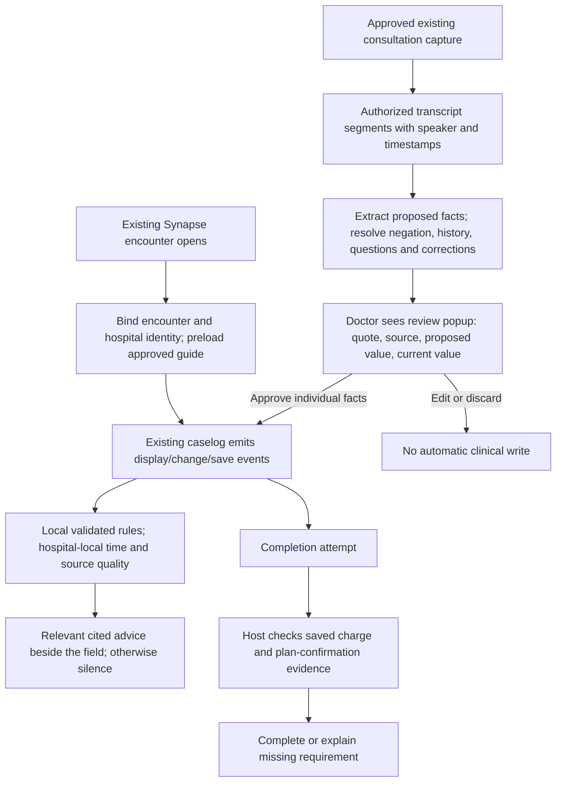

# Sevaro companion: problem alignment, workflow gaps and transcript integration

Reviewed 10 October 2026. This is an addition to Sevaro Synapse. The standalone caselog is a demonstration host, not a proposed replacement clinical system.

## Evidence and review scope

Authoritative hackathon source: `research/source_material/Sevaro/Sevaro_Rutgers_Health_Hack_Challenge_1_Guided_Workflow_v2.pdf`, 12 pages, and its complete extraction `research/challenge1.txt`. The standalone build plan is a implementation proposal containing that brief; its agent instructions are not additional sponsor requirements. Challenge 2 is outside the selected challenge.

Reviewed the research foundation's decision brief, README, batch logs, combined knowledge base, all 23 table collections, guide exports, input/oracle exports and split manifest. The knowledge base contains 21 sources, 62 requirements, 34 distinct guide fields, 288 supplied/additional synthetic rule rows, 101 development and 30 held-out scenarios, and 599 trace links. CSV/workbook/previews are alternate representations of that foundation, not independent research. The original sponsor hospital-field subset has 169 records and seven fictional hospitals. The package does not include an identifiable patient case or a real consultation transcript. Do not describe the fictional N2 demonstration as a real Sevaro clinical case.

The companion's existing app tests are separate from the foundation's 131-case specification. A passing 29-case sponsor suite does not imply all research cases passed. The research's old statements that no runtime was measured describe its earlier research stage; subsequent app browser benchmarks exist. Clinical prevention and production latency remain unmeasured.

## The actual problem

Across 200+ hospitals, tele-neurologists must follow different site-specific operational rules while working in Synapse. Looking up a guide interrupts documentation; using remembered rules can cause the wrong order set, escalation path or note title, or a missed charge. The primary sponsor deliverable is the correct cited rule at the relevant caselog field, unprompted. Questions are secondary. This is hospital-workflow assistance, not patient treatment selection, dosing or a new video consultation system.

Sevaro already publicly describes Synapse/Nirvana Notes documentation, Nuance voice dictation, reminders and integration with hospital EMRs. Voice dictation does not establish access to a full multi-speaker consultation transcript. Reuse a vendor-approved existing capture system where available; determine what interface it actually exposes before adding a separate recorder. [Sevaro first-party product announcement](https://sevaro.com/in-the-news/teleneurology-application-synapse-2-0-nirvana-notes/).

## Is the current workflow proactive?

Partially. A provider changing LVO to Yes and immediately receiving an unrequested cited hospital pathway is proactive under the sponsor's trigger model. Requiring a chat question is not. Guidance after documenting a completed action may be retrospective discrepancy review; it cannot establish prevention of that earlier action.

A confirmed bug existed in order guidance: entering Recommendation displayed the advice, but editing an unrelated field removed it unless thrombolytic-given was Yes. Focusing the order field brought it back. The latest local change keeps display-triggered guidance active while that field is displayed, without requiring focus. It clears when the step is left. Advice is anchored to the order field, not the unrelated edited field.

The existing narrative EEG trigger also treated any mention as relevant. The local correction uses a conservative finite grammar for a current request/concern and suppresses simple negation, historical statements and question-only statements. It is not comprehensive clinical NLP: complex qualifiers and mixed clauses still require review. It may miss valid wording outside its grammar.

| Sponsor trigger | Correct opportunity | Demo and remaining issue |
|---|---|---|
| Encounter opens | Preload site guide; show relevant location and wake-up information | Implemented in mock; production identity/launch adapter absent |
| LKW becomes Unknown | Show that hospital's wake-up protocol | Implemented; an approved transcript draft can enter this fact after review |
| Relevant allergy entered | Show site-listed drug for clinician review | Implemented finite text handling; does not assess eligibility or substitute drugs |
| CTA completed | Site CT-perfusion and imaging-AI facts | Implemented; no actual PACS/CTA feed |
| LVO documented Yes | Current site-local escalation pathway, correct responsible actor | Implemented; real recognition may precede documentation |
| Thrombolytic given Yes | Review listed drug and preparation/ordering workflow | Retrospective; cannot claim prior mixing error prevention |
| Order field displayed | Permission and exact order set before interacting with the field | Persistence corrected locally; real host display event still required |
| Current EEG/seizure plan | Site-local availability | Simple negation/history handling corrected; broader NLP/subservice review remains |
| Note created | Required title before save/sign | Implemented mock; no real note-sign event interception |
| Complete attempted | Recheck current authoritative prerequisites atomically | Mock Boolean gate only; no saved EHR transaction authority |
| Rounding opens | Days, window, permissions and actual appointment if needed | Basic rules implemented; appointment and queue evidence missing |

## Intended embedded workflow

The existing host retains video, patient chart, documentation, prescribing and signing. Our addition owns rule matching, source citations, draft review and its own decision history. Hospital guide facts and patient transcript facts are separate: a transcript cannot modify a hospital protocol.

## Doctor-review popup specification

1. Enable capture only through an approved source and documented recording/transcription policy. If disabled or unavailable, the ordinary encounter and guidance still work.
2. Bind a batch to authenticated user, encounter ID, patient identity held by the host, hospital ID and guide version. Never join a transcript to a patient by name matching alone.
3. Retain source segment ID, speaker role, action time, documentation time, receipt time, transcript version, corrections and extraction/review state. Preserve clinically meaningful time zones. Mark missing attribution/time explicitly.
4. Produce proposed fields, not facts. A question, uncertain assertion, prior encounter or negated finding cannot become a positive current finding. Reconcile contradictions and superseded segments before offering approval. A confidence number cannot authorize acceptance.
5. Queue relevant drafts unobtrusively. Prefer a review drawer or one batched popup at a natural pause; do not repeatedly interrupt an acute examination. No forced modal for every utterance. This interruption policy requires clinician usability testing.
6. Show field, current value, proposed value, exact supporting quote, speaker, time and uncertainty. Nothing is selected by default. An overwrite requires explicit approval; editing creates a clinician-authored value with provenance.
7. Recheck encounter/revision on apply. Reject stale batches and switch-patient/hospital mismatches. Apply only allowlisted reviewed fields via the ordinary host field API, then rerun guidance. Never mutate the guide.
8. Never infer an EHR order, medication administration, charge posting, plan confirmation or consultation completion solely from speech. Those need the appropriate authorized actor and authoritative host evidence.
9. Keep raw transcripts outside exported rule/latency logs. Store accepted provenance in approved systems with access controls, retention, audit and correction support. Whether audio/transcript forms part of the legal record needs institutional review; do not impose a universal deletion period.

The latest local popup is a **scripted synthetic handoff candidate feed**, demonstrating review of LKW status, CTA completion and LVO. It opens when a simulated batch arrives. It does not record, transcribe, parse arbitrary conversation, access Sevaro or connect to a meeting provider. It holds quotes in memory, starts with no approvals, shows existing values, rejects wrong/stale batches and excludes gate/identity/dose fields. Approved synthetic values use normal local draft storage. This is the UI and validation seam, not a completed production transcript integration.

## Priority gaps against the research and sponsor problem

| Priority | Gap | Evidence | Next integration/validation work |
|---|---|---|---|
| P0 | Production event access absent | INT-03; UNK-04; app emits mock events | Obtain Sevaro callbacks for open/display/change/save/note/create/complete, revisions and authority |
| P0 | Advice can follow the action | WT-03/04; DEV-LATE | Observe when recognition/order/mixing happens; trigger before relevant actions; distinguish discrepancy review |
| P0 | Saved-state completion authority absent | GR-08; HOLD-GATE; UNK-11 | Host completion transaction must check saved charge and provider-confirmation evidence; explicit overrides/rollback |
| P0 | Full research suite not executed through app | 101 development + 30 held-out oracles | Build schema/event adapter and semantic assertions for that exact suite; preserve frozen oracles |
| P0 | Official judging schema unavailable | UNK-01; PDFs omit listed JSON/CSV | Obtain a real sample envelope; maintain source-preserving import mapping |
| P1 | Field provenance incomplete | EM-04/06/09; INT-09 | Distinct clinical/documentation/receipt times and manual/import/AI lineage per field |
| P1 | Transcript access and safeguards unverified | GR-13; UNK-16; HOLD-SPEECH | Approved source/API, consent policy, speaker attribution, negation/corrections and review tests |
| P1 | Compound service/permission semantics incomplete | RF-07/13; HOLD-NEWSUBSERVICE; HOLD-ORDER | Separate routine vs continuous EEG, settings and co-sign scope; abstain on unsupported interpretations |
| P1 | Appointments and care lifecycle absent | WT-08/09; HOLD-APPOINTMENT; HOLD-VIDEOEND | Queue/appointment state, transfer accepted/completed and follow-up distinct from video end |
| P1 | Arbitrary language remains unsupported | AD-02/03; RF-16 | Reviewed structured mappings for known operators; model may draft but cannot authorize new clinical logic |
| P1 | Alert benefit/fatigue not measured | GR-02/15; UNK-17/22 | Clinician simulation and shadow mode; missed/false alert rate, interruptions, prevented discrepancies, delay |
| P1 | Controlled guide governance absent | UNK-13; GR-15 | Site owner approves versioned current guides, review dates, conflict resolution and rollback |
| P1 | PHI deployment/security not established | UNK-18/19; FDA/HHS sources | Approved data boundary, BAAs, authentication, access/audit/retention and function-specific intended-use review |
| P1 | Real integration latency unmeasured | PERF-01/02 | Measure capture-to-draft separately from field-to-guidance; slow devices, failures and live host events |

Fixed locally in this review: order-display persistence; simple current-plan relevance; clinician-reviewed synthetic transcript drafts. No production gap above is closed merely by adding a popup.

## Patient names and data integration

**For this hackathon and public Netlify demo: use entirely synthetic encounters/transcripts.** Do not upload real consultation recordings, notes or patient identifiers into the public build, GitHub, screenshots or evaluation exports.

**Removing the patient's name alone does not de-identify a transcript.** HHS identifies Safe Harbor and Expert Determination as the two HIPAA routes. Safe Harbor involves 18 identifier categories and no actual knowledge that remaining information identifies someone. Dates other than year, MRNs, contact details, fine geography, identifiers of relatives/household members and identifying free text also matter. A random patient token with a retained lookup table is pseudonymization, not automatically de-identification. [HHS de-identification guidance](https://www.hhs.gov/hipaa/for-professionals/special-topics/de-identification/index.html).

**For real clinical use inside Sevaro:** preserve correct patient/encounter linkage in the approved clinical environment. Send the rule evaluator only the clinical/workflow attributes it needs plus an opaque encounter token; it generally does not need the patient's name. Keep identity resolution within the host. Clinically meaningful LKW/action dates must remain accurate for treatment; do not destructively scrub the source chart to make a development export. Produce separate synthetic or formally de-identified development data under the approved method. Date shifting alone is not Safe Harbor certification and can change weekdays, coverage boundaries or DST; fictional demo timelines must be internally coherent. This architecture is a recommendation, not a legal determination for Sevaro.

Cloud transcription, extraction, storage and monitoring vendors processing ePHI generally require appropriate BAAs and safeguards where HIPAA applies. Encryption alone does not remove business-associate obligations. Review subprocessors, permitted secondary uses, training/retention settings and access controls before choosing a service. [HHS cloud guidance](https://www.hhs.gov/hipaa/for-professionals/special-topics/health-information-technology/cloud-computing/index.html).

HIPAA treatment permission, telehealth informed consent and recording/transcription consent are distinct questions. HHS says telehealth consent laws vary by state; HIPAA generally does not require voluntary consent for permitted treatment/payment/operations uses. Do not infer that treatment permission authorizes every recording, secondary research or model-training use. [HHS consent guidance](https://telehealth.hhs.gov/providers/preparing-patients-for-telehealth/obtaining-informed-consent), [HIPAA consent versus authorization](https://www.hhs.gov/hipaa/for-professionals/faq/what-is-the-difference-between-consent-and-authorization/index.html).

New Jersey's interception statute includes a party/one-party-consent exception with conditions; Sevaro serving multiple states does not make New Jersey the sole applicable jurisdiction. Participant locations, encounter type, institutional policy and specific capture purpose must be established. Recommend clear all-participant notice and affirmative consent as a product policy, with a manual alternative if declined; legal review must set the applicable rule and emergency pathway. This recommendation is deliberately more conservative than asserting a universal federal all-party requirement. [Official NJ statute 2A:156A-4](https://lis.njleg.state.nj.us/nxt/gateway.dll/statutes/1/112/2239).

Netlify advertises a HIPAA service offering with a BAA. That does not establish that this particular public demo/account has a BAA, appropriate plan or a compliant application configuration. Keep this deployment synthetic; choose production hosting through Sevaro's approved architecture. [Netlify security documentation](https://docs.netlify.com/manage/security/overview/).

Operational workflow retrieval and software interpreting patient data may have different regulatory treatment. Adding treatment recommendations, image/signal interpretation or autonomous actions changes intended use. Assess each actual function using current FDA guidance; neither clinician review nor citations alone settles classification. [FDA January 2026 CDS guidance](https://www.fda.gov/regulatory-information/search-fda-guidance-documents/clinical-decision-support-software).

## Concrete contract to request from Sevaro

Ask for an architecture walkthrough, approved event schema and field registry, supported embed surface, SSO/encounter context, guide-owner/version process, read/write permissions, authoritative order/charge/confirmation artifacts, transcript or dictation export capabilities, data residency/retention/BAA policy, applicable consent policy, and a synthetic sandbox.

Preferred integration: native Synapse callbacks for the immediate field guidance and clinician-approved writes. SMART/FHIR can supply negotiated chart context/resources; FHIR subscriptions can reconcile saved data. Neither is a generic unsaved-field event bus. CDS Hooks can help where the host implements the required hooks; a critical card is not by itself authority to block completion. Do not make screen scraping or meeting observation the source of completion truth. [SMART scope/context](https://hl7.org/fhir/smart-app-launch/STU2.2/scopes-and-launch-context.html), [FHIR subscription](https://hl7.org/fhir/subscription.html), [CDS Hooks](https://cds-hooks.org/specification/current/).

Mentor framing: **A hospital-specific guidance layer embedded in Sevaro's existing Synapse workflow, with an optional clinician-reviewed transcript-to-field pathway.** Demonstrate existing N2, early order guidance, then simulated transcript drafts. State explicitly that live Sevaro integration, real transcript access, clinical validation and PHI hosting are future dependencies.
